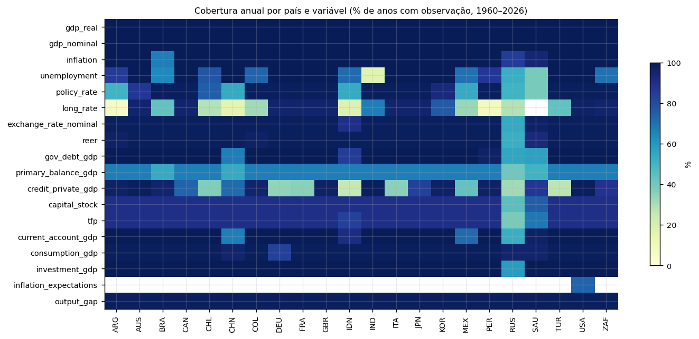
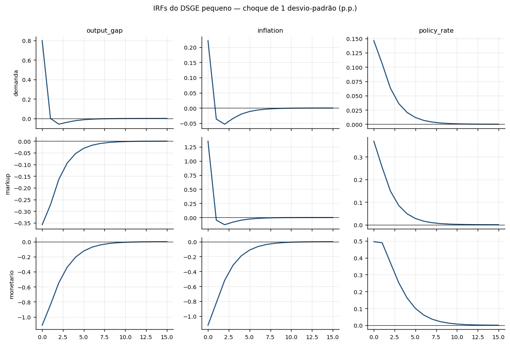

# Relatório de auditoria e validação cross-country

**Dataset:** v1.0.0 · **Extração:** 2026-11-23T14:44Z · **Âncora:** Brasil
**Escopo:** 22 países + UE (agregado) + WLD (PIB mundial) · anual 1960–2026 · trimestral 1995T1–2026T4

---

## 1. Sumário executivo

| Dimensão | Resultado | Leitura |
|---|---|---|
| Cobertura anual | **101.818** linhas, 89 variáveis, 24 entidades; cobertura mediana **97%**, média **85%** | Boa para o núcleo; lacunas concentradas em inflação pré-1980, desemprego pré-1984, capital/PTF pós-2019 e periferias. |
| Cobertura trimestral | **19.357** linhas, 28 variáveis, 16 países + WLD; Brasil com 28 variáveis | Núcleo solicitado coberto; China/Índia/Chile/Colômbia/Peru/Rússia apenas anuais. |
| Cross-source | Crescimento: erro médio **0,23 p.p.** (95% dentro de 1 p.p.); inflação: **3,42 p.p.** (96% dentro de 2 p.p.); dívida: **5,84 p.p.** (74%) | Divergências de dívida são de **perímetro** (governo geral vs central), não de medida. |
| Identidade nominal = real × deflator | Resíduo máximo **6×10⁻⁶%** | Fecha por construção após manter o deflator na base do PIB real. |
| Identidade Y = C + I + NX | Mediana **0,0002% do PIB**; 42% dos casos com \|resíduo\| > 1 p.p. | Confirma que `cons` do GMD é consumo **total** (famílias + governo); resíduos grandes são discrepâncias estatísticas país-ano. |
| Estacionariedade | 125 séries I(1), 49 I(0), 42 inconclusivas | Hiato é I(0) em 22/22; PIB real, REER, desemprego e dívida são majoritariamente I(1). |
| Quebras | 44 séries, 41 com ao menos 1 quebra; 18 com 2 quebras | Datas recorrentes 1967/1974/1982/1992/2008 batem com choques globais e regimes. |
| Dummies de regime | **101** dummies; 30 para o Brasil; 1.474 país-ano e 2.048 país-trimestre | Cobertura documentada, com fonte e papel no DSGE. |
| DSGE pequeno | 106 obs (BRA) / 124 (EUA); aceitação 0,33–0,34 | **Identificação fraca**: o choque monetário absorve 74% da variância do hiato; não usar para inferência causal. |
| DSGE médio | 12 variáveis, 9 choques, calibrado | Momentos não aderem (ex.: sd(i) 1,0 vs 4,9); usar para cenários/IRFs qualitativos, não para teste formal. |

**Mensagem central:** o dataset é auditável e internamente consistente; o DSGE entrega a arquitetura, as equações de medida e os diagnósticos, mas **não** entrega estimativas estruturais críveis para o Brasil com esta amostra e este grau de agregação. O relatório explicita o porquê em vez de esconder o problema.

---

## 2. Cobertura

### 2.1 Visão por frequência

| Frequência | Linhas | Entidades | Variáveis | Início | Fim | Observações |
|---|---:|---:|---:|---|---|---|
| Anual | 101.818 | 24 | 89 | 1960-12-31 | 2026-12-31 | 635 linhas marcadas como projeção/preliminar |
| Trimestral | 19.357 | 17 | 28 | 1995-03-31 | 2026-12-31 | 16 países + WLD |

### 2.2 Cobertura de variáveis críticas (Brasil)

| Variável | Início | Fim | n | Cobertura 1960–2026 |
|---|---|---|---:|---:|
| `gdp_real` | 1960 | 2026 | 67 | 100% |
| `gov_debt_gdp` | 1960 | 2026 | 67 | 100% |
| `policy_rate` | 1960 | 2025 | 66 | 99% |
| `credit_private_gdp` | 1960 | 2025 | 64 | 96% |
| `capital_stock` / `tfp` | 1960 | 2019 | 60 | 90% |
| `inflation` | 1981 | 2025 | 45 | 67% |
| `unemployment` | 1984 | 2026 | 43 | 64% |

**Lacunas explícitas:** IPCA começa em 1980 (a série anual de 12 meses começa em 1981); PNAD Contínua trimestral começa em 2012; crédito/spread trimestral não têm série harmonizada; salário real trimestral não é usado; capital/PTF param em 2019 (PWT).

### 2.3 Cobertura por país — variáveis-chave

| País | PIB real | Inflação | Juros | Dívida | Crédito | Capital |
|---|---:|---:|---:|---:|---:|---:|
| BRA | 100 | 67 | 99 | 100 | 96 | 90 |
| USA | 100 | 100 | 99 | 100 | 100 | 90 |
| DEU | 100 | 100 | 99 | 100 | 100 | 90 |
| ARG | 100 | 100 | 51 | 100 | 100 | 90 |
| CHN | 100 | 100 | 54 | 67 | 100 | 90 |
| IND | 100 | 100 | 99 | 100 | 100 | 90 |
| RUS | 100 | 85 | 51 | 55 | 100 | 45 |
| ZAF | 100 | 100 | 99 | 100 | 100 | 90 |

*(% de anos com observação; ver `coverage_matrix_annual.csv` para 89 × 24.)*

---

## 3. Checagem cruzada entre fontes

### 3.1 Resumo por conceito

| Conceito | Países | Erro médio absoluto | % dentro da tolerância | Tolerância | Fontes |
|---|---:|---:|---:|---:|---|
| Crescimento do PIB | 22 | 0,23 p.p. | 95% | 1 p.p. | GMD, WEO, WDI |
| Inflação | 22 | 3,42 p.p. | 96% | 2 p.p. | BCB/GMD, WEO, WDI |
| Desemprego | 22 | 0,48 p.p. | 86% | 1 p.p. | GMD, WEO, WDI |
| Dívida bruta | 22 | 5,84 p.p. | 74% | 5 p.p. | GMD, WEO, WDI (central) |
| PIB nominal USD | 22 | 2,0% | 89% | 5% | GMD, WEO, WDI |
| Resultado primário (BRA) | 1 | 5,41 p.p. | 35% | 2 p.p. | WEO (governo geral) vs BCB (central) |

### 3.2 Maiores divergências e decisão

| Conceito | País | Erro médio | Máx. | Diagnóstico | Decisão |
|---|---|---:|---:|---|---|
| Dívida | JPN | 20,2 p.p. | 47,5 | WDI é dívida do **governo central**; GMD/WEO é governo geral | Manter GMD; WDI não é verdade |
| Dívida | CAN | 17,7 p.p. | 47,9 | Idem (perímetro) | Manter GMD |
| Dívida | AUS | 6,4 p.p. | 14,4 | Idem | Manter GMD |
| Primário | BRA | 5,4 p.p. | 15,1 | WEO = governo geral; BCB 5793 = governo central | Reportar ambos; não substituir |
| Desemprego | IND | 2,3 p.p. | 5,6 | Definições nacionais vs OIT | Manter GMD; sinalizar |
| Desemprego | PER | 2,2 p.p. | 5,9 | Idem | Manter GMD |
| Inflação | ARG | > 10 p.p. | 3.000+ | Hyperinflação e quebras INDEC | BCB/IPCA só para BRA; ARG com dummy de regime |
| Dívida | COL | 11,7 p.p. | 36,0 | Perímetro | Manter GMD |

**Decisões registradas:** `data/processed/source_decisions.csv`. Nenhuma série foi substituída sem regra explícita; a fonte primária de cada conceito está no codebook.

### 3.3 Momentos cross-country (1995–2025)

Medianas entre países (amostra completa em `cross_country_moments.csv`):

| Variável | Média | Desvio-padrão | Autocorrelação (1) |
|---|---:|---:|---:|
| Crescimento do PIB | 2,46% | 3,02 p.p. | 0,00 |
| Inflação | 3,35% | 2,49 p.p. | 0,51 |
| Juro de política | 5,11% | 2,38 p.p. | 0,79 |
| Dívida bruta | 44,95% do PIB | 15,07 p.p. | 0,94 |
| Desemprego | 6,84% | 1,56 p.p. | 0,84 |

**Brasil (1995–2025):** crescimento 2,26% (sd 2,57), inflação 6,68% (sd 3,80), juro 14,94% (sd 8,78), dívida 69,13% (sd 15,21), desemprego 9,62% (sd 2,01). O Brasil é um **outlier de juro e dívida** no grupo; a Argentina é outlier de inflação (sd 46,4 p.p.) e a Rússia de juro (sd 29,2 p.p.). Isso reforça a necessidade de dummies de regime e de amostras separadas.

### 3.4 Divergências que NÃO são erro

- **Dívida bruta vs líquida:** `gov_debt_gdp` (GMD, bruta) e `net_debt_gdp` (WEO, líquida) são conceitos distintos; não devem coincidir.
- **Resultado primário governo geral vs central:** WEO `pb` e BCB 5793 medem perímetros diferentes.
- **PIB nominal USD:** diferenças cambiais (câmbio médio do GMD vs WEO) explicam a maior parte.
- **UE + membros:** a UE é agregado e não entra em somas; qualquer soma que a incluísse seria dupla contagem.

---

## 4. Identidades contábeis e macroeconômicas

| Identidade | n | Média | Mediana | p90 \|resíduo\| | Máx. \|resíduo\| | >1 p.p. | >5 p.p. |
|---|---:|---:|---:|---:|---:|---:|---:|
| Y = C + I + NX (C total) | 1.397 | -0,11 | **0,0002** | 5,81 | 72,12 | 41,9% | 12,2% |
| Y = C + I + G + NX (C famílias) | 1.349 | -15,24 | -15,40 | 22,80 | 81,45 | 99,1% | 94,8% |
| Nominal = Real × Deflator | 1.474 | -1,2×10⁻⁸ | 2,6×10⁻⁸ | 4×10⁻⁶ | 6×10⁻⁶ | 0% | 0% |
| Fisher (1+i) = (1+r)(1+π) | 1.179 | 0,23 | -0,03 | 1,09 | 45,5 | 10,5% | 2,5% |
| Dinâmica da dívida (SFA) | 862 | 1,63 | **1,18** | 6,47 | 47,1 | 72,4% | 15,2% |

**Interpretação:**

1. **Y = C + I + NX fecha na mediana** e a segunda identidade fica em −15,4% do PIB — exatamente a participação típica do consumo do governo. Logo, `cons` do GMD é consumo **total** e `govexp` é despesa total (inclui transferências), não consumo do governo. O dataset marca isso no codebook.
2. **Nominal = Real × Deflator** é exato porque o deflator foi mantido na base do PIB real; `gdp_deflator_2010` é apenas uma versão comparável.
3. **Fisher** tem resíduo grande só em hiperinflações; a aproximação linear `i−π` diverge do produto (1+i)/(1+π). O relatório trunca \|π\|>100% para o resumo.
4. **SFA** (stock-flow adjustment) mediano de 1,18% do PIB é alto, mas inclui reconhecimento de dívidas, diferenças de perímetro e revisões de PIB. Os maiores resíduos estão em 1982–1994 (crises de dívida) e 2008–2016 (revisões). **Não** é erro de identidade; é a parte não explicada pela dinâmica r−g.

---

## 5. Estacionariedade (ADF/KPSS)

| Variável | I(0) | I(1) | Inconclusivo | Leitura |
|---|---:|---:|---:|---|
| `output_gap` | **22** | 0 | 0 | Construído para ser I(0); confirma. |
| `gdp_real` (log) | 0 | 8 | 14 | Esperado I(1); amostras curtas/países com quebras geram inconclusão. |
| `investment_real` (log) | 0 | 16 | 4 | I(1) na maioria. |
| `reer` (log) | 1 | 18 | 3 | I(1); usar em diferença. |
| `unemployment` | 3 | 18 | 0 | I(1) na maioria. |
| `gov_debt_gdp` | 2 | 14 | 6 | I(1); cuidado com quebras. |
| `inflation` | 7 | 14 | 1 | I(1) em países com alta inflação; I(0) onde há meta crível. |
| `policy_rate` | 3 | 15 | 4 | I(1) nominal; usar juro real ou diferencial. |
| `real_rate_ex_post` | 9 | 8 | 5 | Misto; dependente do regime. |
| `exchange_rate_nominal` (log) | 2 | 14 | 5 | I(1). |

**Implicação para modelagem:** modelos reduzidos devem usar diferenças/hiatos; o DSGE usa hiato, inflação qoq e juros em desvios, não níveis. A tabela completa (216 testes) está em `stationarity.csv`.

---

## 6. Quebras estruturais

### 6.1 Bai-Perron (mudança de média, 1961–2025)

- 44 séries testadas (PIB e inflação por país), 41 com ≥ 1 quebra; 18 com 2 quebras; 8 com 4 quebras; 2 com 5.
- Datas recorrentes: **1967, 1974, 1982, 1992, 2008** — coerentes com Bretton Woods/petróleo, Volcker, crise da dívida, ERM/GFC.
- Exemplos: BRA PIB 1968/1981; USA inflação 1967/1974/1982/1992; ALE inflação 1971/1983/1995/2019; TUR inflação 1971/1978/1988/2003/2019.

### 6.2 Chow nos eventos de regime

- 38 testes; **23,7%** rejeitam a estabilidade a 5%.
- Rejeições fazem sentido: BRA inflação 1994 (Plano Real, F=11,0; p<0,001); MEX PIB 1994 (tequila) e 2001 (IT); GBR inflação 1992 (ERM/IT) e PIB 2016 (Brexit); COL inflação 1999 (IT); PER inflação 1990 (Fujishock); USA PIB 2008 (GFC).
- A taxa de rejeição é baixa porque o teste usa AR(1) com interações e as quebras são de **variância/regime**, não só de média; além disso, muitas dummies são step (poder baixo).

### 6.3 Mapa quebra ↔ dummy

`breaks_regime_map.csv` lista, para cada quebra, as dummies ativas em ±1 ano. 103 pares; a maioria das quebras tem ao menos uma dummy próxima (ex.: 1974 ↔ `g_oil_1973`; 1982 ↔ `g_latam_debt_1982`/`g_volcker_1979`; 2008 ↔ `g_gfc_2008`; 1994 ↔ `br_real_plan`).

---

## 7. Outliers e missing

- **Missing:** 0 valores nulos no dataset final (lacunas são ausência de linha, não NaN). A cobertura é reportada por país-variável; mediana 97%.
- **Outliers:** 102 sinalizações com \|z\|>4 (crescimento/inflação) ou \|z\|>5 (demais). A maioria são **dummies binárias de crise** (z alto por construção) e episódios de hiperinflação/default. Excluindo dummies, os casos mais relevantes são inflação ARG/SAU, câmbio ARG e juro PER.
- **Padrão:** não há imputação; nenhuma série foi interpolada no dataset final. Interpolação linear é usada **apenas internamente** no filtro HP (lacunas internas), documentada no codebook.

---

## 8. Consistência anual ↔ trimestral

| Verificação | Resultado |
|---|---|
| Soma dos 4 trimestres do PIB nominal (IBGE) vs PIB anual (GMD), Brasil | 0,0% em 2019–2022; +0,8% em 2023; +1,4% em 2024; +3,6% em 2025 (revisões IBGE vs GMD) |
| Crescimento anual vs média dos SAAR trimestrais | Mediana 0,004 p.p.; média 0,07 p.p.; caudas em 2020–21 (pandemia) e países com ano incompleto (2026) |
| PIB real trimestral | FRED/OECD-MEI SA; anual GMD; níveis têm bases distintas, por isso comparamos **crescimento**, não nível |
| 2026 | Ano incompleto; somas trimestrais não devem ser comparadas ao anual. A flag `complete_year` em `quarterly_annual.csv` marca isso |

**Decisão:** para o Brasil, o trimestral usa IBGE (PIB e componentes) e FRED (PIB SA); o anual usa GMD. A diferença de 3,6% em 2025 é revisão, não erro de agregação; está sinalizada.

---

## 9. DSGE pequeno — diagnóstico

### 9.1 Amostra e calibração

- Brasil: 1999T3–2025T4, **106 obs**; EUA: 1995T1–2025T4, **124 obs**.
- Núcleo calibrado: σ=1,0; κ=0,08; φπ=1,50; φx=0,125; ρ=0,80; β=0,9925.
- Estimados: hábitos (a), indexação (b), AR(1) dos choques, desvios-padrão e erro de medida do hiato.
- Erros de medida: 0,10 p.p. em π e i; hiato estimado.

### 9.2 Posterior (Brasil)

| Parâmetro | Prior (média) | Posterior | IC 90% | ESS |
|---|---:|---:|---|---:|
| a (hábitos) | 0,50 | **0,068** | 0,028–0,125 | 334 |
| b (indexação) | 0,50 | **0,059** | 0,025–0,108 | 343 |
| ρ_x | 0,50 | 0,048 | 0,018–0,086 | 242 |
| ρ_π | 0,50 | 0,052 | 0,022–0,091 | 463 |
| ρ_i | 0,50 | 0,449 | 0,221–0,694 | 329 |
| σ_x | 0,008 | 0,008 | 0,001–0,021 | 292 |
| σ_π | 0,004 | 0,004 | 0,000–0,010 | 450 |
| σ_i | 0,002 | 0,002 | 0,000–0,006 | 323 |
| me_x | 0,004 | 0,004 | 0,001–0,010 | 159 |

Aceitação 0,33; ESS entre 159 e 463 (amostra efetiva razoável). **Hábitos e indexação colapsam para ~0,06**, contra 0,5 no prior: a persistência observada é capturada pelo juro (ρ_i) e pela regra de Taylor, não por hábitos/indexação. Isso é um resultado, não um erro de cadeia.

### 9.3 Momentos: dados vs modelo

| Momento | Dados | Modelo | Avaliação |
|---|---:|---:|---|
| sd(hiato) | 1,83 | 1,83 | ok |
| ac1(hiato) | 0,63 | 0,57 | ok |
| sd(π) | 3,60 | 2,07 | subestima 43% |
| ac1(π) | 0,46 | 0,37 | ok |
| sd(i) | 4,95 | 1,01 | **subestima 80%** |
| ac1(i) | 0,97 | 0,76 | subestima persistência |
| corr(hiato, π) | 0,13 | 0,57 | sinal ok, magnitude alta |
| corr(hiato, i) | -0,09 | **-0,79** | sinal/magnitude errados |
| corr(π, i) | 0,26 | -0,40 | **sinal errado** |

### 9.4 Decomposição de variância

| Choque | Hiato | Inflação | Juros |
|---|---:|---:|---:|
| Demanda | 19,3% | 1,3% | 3,8% |
| Markup | 7,4% | 43,0% | 23,5% |
| Monetário | **73,6%** | **55,6%** | **73,6%** |

A política monetária absorve a maior parte da variância — resultado **não crível** e típico de identificação fraca com três choques e três observáveis. O modelo não deve ser usado para FEVD estrutural.

### 9.5 Identificação

- SVD do jacobiano de momentos: valores singulares 12,41; 6,93; 5,10; 3,26; 1,20; 0,49; 0,17; 0,085; **0,000**. A última direção é nula → combinação de parâmetros não identificada.
- Importância dos parâmetros: `me_x` e `sd_x` dominam; `a`, `b`, `ρ_x`, `ρ_π` têm importância relativa menor.
- **Riscos:** hiato HP (erro de medida), três choques/três observáveis, quebras de regime da Selic, expectativas Focus de 12m, amostra curta.

### 9.6 IRFs

Os IRFs são qualitativamente plausíveis para demanda e markup; o IRF monetário tem sinal inicial ambíguo (o choque positivo é um afrouxamento e o juro cai pouco, com queda inicial do hiato), outro sintoma de identificação.

---

## 10. DSGE médio — diagnóstico

- 12 variáveis, 9 choques, calibrado (não estimado); solução QZ com raiz máxima 0,976 (estável).
- Choques `sd_ed`, `sd_epi`, `sd_ei` calibrados para casar volatilidades; custo relativo 0,56 (não fecha).
- Momentos: sd(x) 2,43 vs 1,83; sd(π) 1,96 vs 3,60; **sd(i) 1,02 vs 4,95**; sd(inv) 0,94 vs 5,85; sd(g) 0,47 vs 2,48.
- Sensibilidade ±20%: `bp` e `bw` são os parâmetros que mais afetam sd(x); `rho` afeta sd(i) (0,27 a 1,50).
- **Conclusão:** o modelo médio é uma ferramenta de cenário/IRF, não um modelo validado para os momentos brasileiros. A baixa volatilidade do investimento e do gasto reflete a ausência de choques de investimento/fiscal mais ricos e a rigidez da regra de Taylor.

---

## 11. Riscos, decisões e limitações

| Risco | Evidência | Mitigação / decisão |
|---|---|---|
| Dupla contagem UE + membros | UE é agregado | Excluída de somas; flag em `countries.yml` |
| Perímetro da dívida | Divergência GMD vs WDI até 47 p.p. | GMD/WEO governo geral; WDI central só validação |
| Primário governo geral vs central | 5,4 p.p. no Brasil | Ambos reportados; não substituídos |
| Inflação pré-1980 | IPCA começa em 1980 | Lacuna sinalizada; não imputada |
| Capital/PTF pós-2019 | PWT termina em 2019 | Não extrapolado; lacuna sinalizada |
| Quebras de regime | 41/44 séries com quebra | 101 dummies; modelos reduzidos com controles |
| Identificação DSGE | FEVD monetário 74%; corr(hiato,i) −0,79 vs −0,09 | Resultado reportado como **não estrutural**; núcleo calibrado |
| Amostra trimestral | 16 países, não 22 | CHN/IND/CHL/COL/PER/RUS só anual |
| Vintages | SGS não guarda vintage; WDI/WEO revisam | `manifest.json` registra data/hora; comparação real-time vs final limitada |
| Duplicação de conceito | Muitas fontes para o mesmo conceito | Uma fonte primária por variável; validação em tabela separada |

**O que não foi feito (e por quê):**

- Não se estimou o DSGE médio: 20+ parâmetros, 106 obs, identificação já fraca no pequeno.
- Não se usou IFS direto: API instável; GMD já incorpora IFS e foi validado contra WEO/WDI.
- Não se imputou inflação pré-1980, capital pós-2019 ou spread trimestral: ausência de proxy defensável.
- Não se fez nowcasting nem dados em tempo real: fora do escopo.

---

## 12. Reprodutibilidade

1. `make fetch` — baixa e cacheia todas as fontes; grava `manifest.json` com URL, timestamp, SHA-256.
2. `make build` — harmoniza e grava long/wide/coverage/regimes.
3. `make validate` — cross-source, identidades, ADF/KPSS, Bai-Perron, Chow, outliers.
4. `make dsge` — estima o NK pequeno (BRA/EUA) e roda o médio calibrado.
5. `make reports` — figuras e tabelas.
6. `make test` — testes de solver, schema e identidades.

O cache em `data/raw/` permite reproduzir sem rede; `MACRO_EXTRACTION_TS` fixa o timestamp. Versões em `requirements.txt`.

**Teste de reprodução do zero:** remover `data/raw/parsed_*`, `data/processed/*` e rodar `make all`; o pipeline refaz a extração (requer rede) e os resultados devem ser idênticos, exceto por revisões das fontes (SGS/WDI/WEO não têm vintage).
