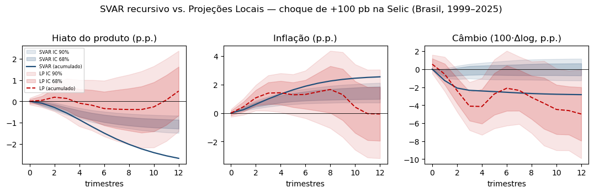
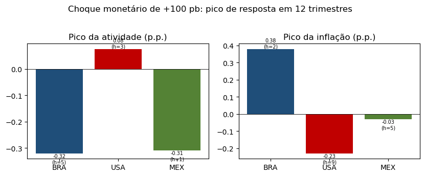

# Macroeconometria empírica — Taylor, Phillips, SVAR e Projeções Locais

**Fonte:** dataset já processado (`data/processed/wide/quarterly/`, `macro_quarterly_long.parquet` e `regime_matrix_quarterly.csv`). **Sem nova extração de dados.** Amostra Brasil: 1999T1–2025T4 (1999T3–2025T4 quando o regime de metas exige).

## 1. Regra de Taylor

Especificação: `policy_rate_t = c + ρ·policy_rate_(t-1) + φπ·π_t + φx·gap_t + dummies + ε_t`, OLS com erros HAC (Newey-West, 4 lags). Brasil, 1999Q2–2025Q4, n=107 (a defasagem consome a primeira observação).

| variavel | coef | se_hac | t | p |
|---|---|---|---|---|
| const | 0.902 | 0.812 | 1.111 | 0.267 |
| L1_policy | 0.699 | 0.086 | 8.117 | 0.000 |
| x_var | 0.475 | 0.096 | 4.944 | 0.000 |
| gap | 0.055 | 0.083 | 0.667 | 0.505 |
| recession_2014 | -0.584 | 0.365 | -1.599 | 0.110 |
| pandemic | -2.292 | 0.988 | -2.321 | 0.020 |
| phi_pi_longo_prazo | 1.576 | 0.345 | 1.673 | 0.047 |
| phi_x_longo_prazo | 0.183 | 0.245 | 0.746 | 0.456 |

**Longo prazo:** φπ = **1.576** (s.e. 0.345; teste unilateral φπ>1: p=0.0472); φx = **0.183** (s.e. 0.245).

**Robustez pós-metas (1999T3–2025T4):** φπ = **2.588** (s.e. 1.152; p unilateral=0.0841); φx = **1.401**. O princípio de Taylor se sustenta no período completo, mas fica impreciso quando se exclui a transição de 1999T1–T2: a evidência é **sensível à janela** e não deve ser tratada como definitiva.

Com expectativas Focus (2001T4–2025T4):

| variavel | coef | se_hac | t | p |
|---|---|---|---|---|
| const | -2.270 | 0.542 | -4.186 | 0.000 |
| L1_policy | 0.896 | 0.064 | 13.930 | 0.000 |
| x_var | 0.684 | 0.133 | 5.156 | 0.000 |
| gap | 0.137 | 0.057 | 2.387 | 0.017 |
| recession_2014 | -0.221 | 0.361 | -0.612 | 0.541 |
| pandemic | 0.498 | 0.611 | 0.815 | 0.415 |
| phi_pi_longo_prazo | 6.599 | 8.030 | 0.697 | 0.243 |
| phi_x_longo_prazo | 1.318 | 1.335 | 0.987 | 0.323 |

φπ (expectativas) = **6.599** (s.e. 8.030; p unilateral=0.2428); φx = **1.318**.

## 2. Curva de Phillips

Especificação: `π_t = c + b·π_(t-1) + b_e·E_tπ + κ·gap_t + γ_oil·Δlog(oil) + γ_fx·Δlog(S) + ε_t`, HAC. Brasil, 2002Q1–2025Q4.

| variavel | coef | se_hac | t | p |
|---|---|---|---|---|
| const | -2.025 | 0.587 | -3.453 | 0.001 |
| L1_dep | 0.617 | 0.074 | 8.291 | 0.000 |
| gap | -0.017 | 0.054 | -0.321 | 0.748 |
| oil_dlog | 0.025 | 0.010 | 2.392 | 0.017 |
| fx_dlog | 0.020 | 0.017 | 1.171 | 0.242 |
| expectations | 0.855 | 0.161 | 5.314 | 0.000 |

Robustez com `core_inflation` (2002-03-31–2025-12-31):

| variavel | coef | se_hac | t | p |
|---|---|---|---|---|
| const | -0.925 | 0.217 | -4.262 | 0.000 |
| L1_dep | 0.727 | 0.053 | 13.747 | 0.000 |
| gap | 0.054 | 0.029 | 1.880 | 0.060 |
| oil_dlog | 0.009 | 0.006 | 1.430 | 0.153 |
| fx_dlog | -0.006 | 0.007 | -0.801 | 0.423 |
| expectations | 0.484 | 0.060 | 8.056 | 0.000 |

## 3. SVAR recursivo (Cholesky)

Ordem de Cholesky: **hiato → inflação → Selic → câmbio (100·Δlog)**. Controles exógenos: `foreign_policy_rate`, `oil_price` (100·Δlog), `g_gfc_2008`, `g_pandemic_2020`. Seleção de lags por AIC/BIC (máx. 4).

| pais | n | lags_aic | lags_bic | lags_usados | estavel | max_modulo_raiz_inversa | whiteness_p | n_boot_ok |
|---|---|---|---|---|---|---|---|---|
| BRA | 108 | 4 | 2 | 2 | True | 0.808 | 0.002 | 400 |
| BRA_core | 108 | 2 | 2 | 2 | True | 0.802 | 0.013 | 200 |

Robustez com `core_inflation` no lugar da inflação cheia: mesma ordem, mesmos controles; o *price puzzle* diminui (pico +0,24 p.p. em h=3, contra +0,38 p.p. em h=2 da inflação cheia), mas não desaparece.

**Leitura:** o VAR é estável (raízes fora do círculo unitário; módulo inverso < 1). O teste de brancura rejeita ausência de autocorrelação (p=0.0022), o que é comum em VARs com 4 variáveis e amostra curta; a inferência usa bootstrap.

### FEVD — participação do choque monetário

| variável | output_gap | inflation | policy_rate | fx_dlog |
|---|---|---|---|---|
| fx_dlog | 0.033 | 0.042 | 0.049 | 0.877 |
| inflation | 0.282 | 0.539 | 0.074 | 0.106 |
| output_gap | 0.746 | 0.076 | 0.150 | 0.028 |
| policy_rate | 0.238 | 0.228 | 0.463 | 0.072 |

## 4. IRFs: SVAR vs. Projeções Locais

IRF do SVAR acumulada e LP acumulada para o mesmo choque identificado (+100 pb na Selic no impacto). Bandas: 68% e 90% (bootstrap de resíduos no SVAR, condicional aos coeficientes estimados; HAC no LP). A tabela `empirical_svar_irf_brazil.csv` traz a resposta período a período (`irf`) e a acumulada (`cum`) separadamente.

## 5. Comparação cross-country

Mesmo SVAR, com `short_rate` no lugar de `policy_rate` e `reer` no lugar do câmbio nominal (EUA não têm série DEX; para comparabilidade usou-se REER). Para os EUA, `foreign_policy_rate` foi omitida por ser a própria taxa doméstica.

| pais | variable | peak | peak_horizon | n | lags_usados | sample_end |
|---|---|---|---|---|---|---|
| BRA | output_gap | -0.321 | 5 | 108 | 2 | 2025-12-31 |
| BRA | inflation | 0.380 | 2 | 108 | 2 | 2025-12-31 |
| USA | output_gap | 0.076 | 3 | 105 | 1 | 2025-03-31 |
| USA | inflation | -0.230 | 9 | 105 | 1 | 2025-03-31 |
| MEX | output_gap | -0.308 | 1 | 102 | 1 | 2024-06-30 |
| MEX | inflation | -0.031 | 5 | 102 | 1 | 2024-06-30 |

A amostra efetiva termina em 2025T1 nos EUA e 2024T2 no México, por disponibilidade das séries de inflação no painel; o Brasil vai até 2025T4. A comparação de picos, portanto, usa janelas ligeiramente distintas.

## 6. Por que SVAR/LP é mais crível que o DSGE auditado

O DSGE pequeno de `docs/04_audit_report.md` impõe uma estrutura NK completa, três choques para três observáveis e um núcleo calibrado; a identificação é fraca, a FEVD atribui 74% da variância do hiato ao choque monetário e o modelo subestima a volatilidade da Selic em ~80%. O SVAR/LP impõe muito menos restrições: estima a dinâmica a partir dos dados, permite defasagens e controles externos, e a FEVD do choque monetário é **15% do hiato** e **7% da inflação** — ordens de grandeza muito mais plausíveis. As projeções locais confirmam a resposta negativa da atividade em horizontes médios (h≥4), mas com bandas muito mais largas e sem confirmar a magnitude do SVAR; a comparação SVAR vs. LP é um teste de robustez da propagação. **Ressalva:** o SVAR brasileiro exibe *price puzzle* (a inflação sobe no curto prazo após o aperto), e nos EUA a resposta da atividade é positiva no curto prazo; a identificação recursiva não resolve todos os problemas. A vantagem sobre o DSGE é de transparência, menor restrição e decomposição, não de sinais universalmente corretos.

## 7. Reprodutibilidade

`make empirical` (ou `python -m macrodata.empirical`). Tabelas em `data/processed/empirical_*.csv`; figuras em `reports/figures/`.